<p align="center">
    
</p>

<h1 align="center">synergos</h1>

<p align="center">
    <b>Background components that start, stop, report their health and talk to each other.</b><br>
    Write a handler once, then call it in-process, over an in-memory bus in tests,<br>
    or through RabbitMQ in production, without touching the handler.
</p>

<p align="center">
    <a href="https://npmjs.com/package/synergos"></a>
    <a href="https://github.com/tada5hi/synergos/actions/workflows/main.yml"></a>
    <a href="https://codecov.io/gh/tada5hi/synergos"></a>
    <a href="https://snyk.io/test/github/tada5hi/synergos?targetFile=packages/synergos/package.json"></a>
    <a href="https://conventionalcommits.org"></a>
</p>

<p align="center">
    <a href="#packages"><b>Packages</b></a>
    ·
    <a href="#quick-start">Quick Start</a>
    ·
    <a href="./packages/synergos/README.md">synergos docs</a>
    ·
    <a href="./packages/amqp/README.md">@synergos/amqp docs</a>
    ·
    <a href="#development">Development</a>
</p>

---

## Why synergos?

A backend service rarely does just HTTP. It also runs queue workers, cron jobs and handlers that
other services call. Each of them usually gets its own startup code, its own shutdown code, its
own health check and its own logging, and each one is tied to the transport it was written for.
Testing a queue worker then needs either a broker or a pile of mocks.

synergos gives all of that one shape:

| Concern | Hand-rolled | synergos |
|---|---|---|
| **Lifecycle** | Every worker, consumer and cron job has its own start and shutdown code | One `IComponent` contract: `start()`, `stop()`, `status()`, so you can start, stop and health-check all of them the same way |
| **Health** | Ad-hoc flags, or none | `status()` reports `lastSuccessAt` and `runningSince` |
| **Transport** | Handler code is written against amqplib, Redis or a function call | The handler only sees `(data, context)`. `DirectCaller`, `DispatchCaller` and `WorkerCaller` decide how it is reached |
| **Replies** | A second queue, wired and correlated by hand | `context.handle('buildFinished', …)` emits a reply, `WorkerCaller` publishes it, and the metadata (e.g. a `correlationId`) carries over |
| **Tests** | A broker in CI, or `vi.mock` on the client | `MemoryMessageBusDriver`: in-process, deterministic, and `publish()` rejects with the handler's error |
| **Cron jobs** | Overlapping runs, an unhandled rejection on a failing pass | `defineScheduledComponent`: a first pass on start, no overlap, failures go to a hook |
| **Shutdown** | Exit and hope the handler in flight finished | `WorkerCaller.stop()` waits for the handler in flight |
| **Observability** | A logger dependency in every class | Typed `hooks` (`onError`, `onRetry`, …). A hook that throws is ignored and can never turn an ack into a retry |

The same component, reached three ways:

```typescript
const builder = new Component();
builder.mount('build', async (data, context) => {
    await context.handle('buildFinished', data);
});

// in-process, e.g. in a test or a CLI
const replies = await new DirectCaller(builder).callAndWait('build', { id: '1' }, {});

// through a bus: memory in tests, RabbitMQ in production
await new WorkerCaller(builder, { consumeRouting, publishRouting, messageBus }).start();
await new DispatchCaller({ routing: consumeRouting, messageBus }).call('build', { id: '1' }, {});
```

<p align="center">
    
</p>

## Packages

| Package | Version | Description |
|---|---|---|
| [`synergos`](./packages/synergos) | [](https://npmjs.com/package/synergos) | Components, scheduled components, the message bus with its in-memory driver, and the direct, dispatch and worker callers. One runtime dependency (`node-cron`) |
| [`@synergos/amqp`](./packages/amqp) | [](https://npmjs.com/package/@synergos/amqp) | `AmqpMessageBusDriver`: the message bus over RabbitMQ, with retries and backoff, built on [amqp-extension](https://www.npmjs.com/package/amqp-extension) |

```bash
npm install synergos --save
npm install @synergos/amqp --save # for RabbitMQ
```

Both packages are ESM-only and require Node.js `>=22`.

## Quick Start

```typescript
import {
    Component,
    DispatchCaller,
    MemoryMessageBusDriver,
    MessageBus,
    WorkerCaller,
} from 'synergos';
import type { ComponentMetadata } from 'synergos';

type BuilderEvents = {
    build: [{ id: string }, ComponentMetadata],
    buildFinished: [{ id: string }, ComponentMetadata],
};

const messageBus = new MessageBus({
    driver: new MemoryMessageBusDriver(),
    hooks: { onError: (error, message) => console.error(message.type, error) },
});

// worker side: consume commands, publish the replies
const builder = new Component<BuilderEvents>();
builder.mount('build', async (data, context) => {
    // ... do the work ...
    await context.handle('buildFinished', data);
});

const worker = new WorkerCaller(builder, {
    consumeRouting: { type: 'work', key: 'builder' },
    publishRouting: { type: 'work', key: 'builder-events' },
    messageBus,
});
await worker.start();

// caller side: listen for replies, send a command
await messageBus.consume({ type: 'work', key: 'builder-events' }, {
    buildFinished: (message) => console.log('finished', message.data.id),
});

await new DispatchCaller<BuilderEvents>({ routing: { type: 'work', key: 'builder' }, messageBus })
    .call('build', { id: '1' }, {});

await worker.stop(); // waits for the handler in flight
```

Going to production means swapping one line, the driver:

```typescript
import { AmqpMessageBusDriver } from '@synergos/amqp';

const messageBus = new MessageBus({
    driver: new AmqpMessageBusDriver({
        connectionString: 'amqp://localhost',
        defaultTopicExchange: 'app',
    }),
});
```

The full API is in each package's README: [synergos](./packages/synergos/README.md) and
[@synergos/amqp](./packages/amqp/README.md).

## Development

npm workspaces, orchestrated by [nx](https://nx.dev):

```bash
npm ci
npm run build          # tsc --noEmit + tsdown, every package
npm run test           # vitest, every package
npm run test:coverage  # with v8 coverage and 80% thresholds
npm run typecheck      # src and tests, every package
npm run lint
```

No broker is needed: the amqp driver is tested against a fake client.

## Contributing

Before starting to work on a pull request, it is important to review the guidelines for
[contributing](./CONTRIBUTING.md) and the [code of conduct](./CODE_OF_CONDUCT.md).
These guidelines will help to ensure that contributions are made effectively and are accepted.

## License

Made with 💚

Published under [MIT License](./LICENSE).
